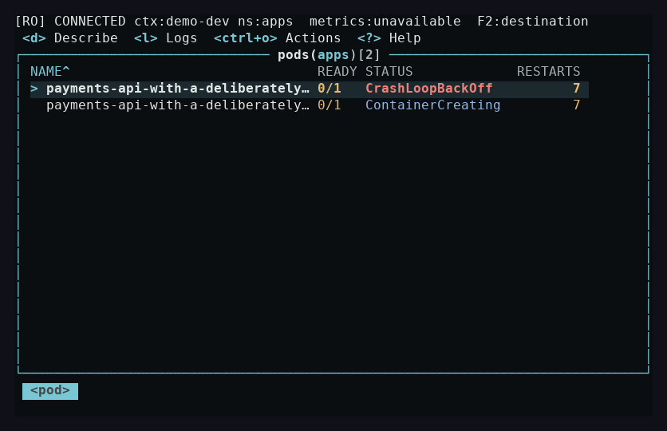

# Presentation and compact terminals

k9+ uses neutral text for names and values, separate category colors for source identity, and health accents for status. Status words, readiness counts, restart counts and an ASCII `>` selection marker carry meaning even without color. Selected rows keep their status foreground on a subdued surface. Resource identity in the model remains complete when a displayed name is shortened.



This actual PTY capture uses synthetic names and a disposable loopback API fixture. The [12-capture evidence index](evidence/ui-2026-10-04/README.md) includes all three skins, both terminal color modes, full destination panels, raw terminal text and the unchanged manifest. Its recorded binary hash is `a28a1f48b72d255348ad72bc4124d5973cc003a4070520c81743bd668aa57747`; the clean final capture was built from source commit `76ac522ff90ce3ddf25d320e911c55c7720b818a` and includes the queued-filter correction.

## Terminal size and actions

`k9s.ui.headerMode` supports `auto` (the default), `compact`, and `full`. Automatic mode displays compact chrome below 120 columns or 34 rows. `Ctrl+E` makes a manual choice that remains in force across resizes. The destination strip stays visible in both modes, in prompts, and while borderless detail/log views expand within the content area. `F2` reveals the complete destination. Compact hints retain complete primary labels and `Ctrl+O` opens searchable actions; `?` opens help. Omitting a hint does not remove its action.

Pod tables reserve full status, readiness and restarts before allocating space to names. Namespace is retained when viewing all namespaces. Metrics, age and node appear when there is room. Names shorten first, and width left over after the other columns are placed is returned to the name. `Ctrl+W` restores the complete column set for horizontal inspection, and resizing recovers the initial column position while preserving selected resource identity.

## Health summary and problems first

A resource list with a status column states how many rows need attention beside its row count, for example `pods(all)[6] 2 failing 1 degraded 1 in progress`. The counts use the same classification that colors the cells. A status word decides a row; a readiness count decides only when no status column speaks; restart counts are history and are not counted. Nothing is added when no row needs attention, and parts are dropped from the least severe when the frame is too narrow.

Failing, then degraded, then in-progress rows are listed ahead of the rest by default, keeping the chosen column order inside each group and the selected resource. The title states `problems first` while a list has rows needing attention. `Shift+X` switches every list to plain column order for the session, and back.

## Cause and trend

Pod lists add a `WHY` column: one phrase taken from the Pod status for a pod that is not running cleanly — the previous exit behind a back-off (`api: last OOMKilled exit 137`), a waiting or scheduling message, an eviction message, or the container that is running but not ready. It reports status evidence only and is empty for a healthy pod. The column is shown from 96 columns when at least one row has a cause; it claims a readable minimum, lets age and usage be placed, then grows into unused width. `Ctrl+W` always shows it in full.

### WHY for other workload kinds

The same column, with the same name, is on the Deployment, StatefulSet, DaemonSet, ReplicaSet, Node, Job, CronJob, PersistentVolumeClaim and Service lists. Each phrase is read from that one object's own spec and status in the list response that is already on screen; no events, pods or other objects are fetched for it.

| List | What WHY reports |
| --- | --- |
| Deployments | `ReplicaFailure` or a `Progressing` condition that is False, as `Reason: message` (`ProgressDeadlineExceeded: …`); a generation the controller has not observed; a paused rollout that is not fully updated; an `Available` condition that is not True; `rollout: 1 of 3 updated`; `1 of 3 unavailable`. |
| StatefulSets, DaemonSets, ReplicaSets | `ReplicaFailure`; an unobserved generation; rollout progress; replicas not created, not scheduled, misscheduled, unavailable or not ready, as counts. |
| Nodes | The `Ready` condition's message when it is False or Unknown (its reason when there is no message), `NetworkUnavailable`, each `…Pressure` condition that is True, and `cordoned`. |
| Jobs | The `Failed` or `FailureTarget` condition as `Reason: message`; `suspended`; `2 pod failures, backoff limit 6` while a job is still retrying. A completed job is empty. |
| CronJobs | `suspended`; `last scheduled run has no recorded success` when nothing is active and the recorded success is older than the last schedule. |
| PersistentVolumeClaims | `no volume bound` (and whether a storage class is set) while Pending, the lost volume name when Lost, and any condition that is True, such as a pending file system resize. |
| Services | `no load balancer ingress assigned` for type LoadBalancer with an empty ingress list. |

The renderer also gives the row a verdict of failing, degraded or in progress, which is what the title summary and problems-first order use for these rows. A Deployment whose rollout passed its deadline is therefore counted as failing although its readiness count alone would only read as degraded, and a failed Job is counted although the Job list has no status column. A phrase without a verdict (`suspended`, `cordoned`) is stated but not counted. The WHY text carries the meaning; its severity color and the color of the row's count cells follow the same verdict.

The column appears only while some listed row reports a cause, so healthy lists look as before. From 96 columns every column keeps its natural width and WHY takes what is left, up to 80 cells; if that is under 24 cells, a long name is elided to 24 and then optional columns are omitted from the right until it is, never name, namespace, status, readiness, Job completions or age. Below 96 columns, lists with a state column keep that column complete, elide the name down to 16 cells if needed, and show WHY when at least 18 cells remain. Elision is marked with an ellipsis and `Ctrl+W` shows the full text.

Limits. WHY is evidence, not diagnosis: it repeats what the API object says and is empty when the object says nothing, which is not proof of health. Why a Deployment's pods fail is on the pods; why a CronJob run failed is on its Job; why a claim is Pending is usually only in events, which are not read here. A CronJob on a cluster that does not record `lastSuccessfulTime` reports nothing. Node conditions added by other agents are not interpreted. At 60 columns a Node or Job list has no room for the column and shows only its state; Services below 96 columns show it only when their natural columns leave room. Custom column views show WHY only if they include it. Counts in the title cover the rows currently listed.

While a list is open it remembers up to eight samples of each row's `CPU` and `MEM` values, taken at most every two seconds, and draws them as a sparkline before the number, scaled from zero to that row's maximum. `RESTARTS` shows the restarts gained since the list was opened as `+N`. This is session memory, not cluster history: it starts empty, is never stored, ignores unavailable values and is dropped when the resource leaves the list. With `noIcons`, the sparkline is replaced by `+`, `-` or `=` comparing the newest sample with the oldest. Sorting, filtering and export use the unchanged values.

## Semantic skin tokens

Existing skins remain supported. An optional `k9s.semantic` object can override `canvas`, `panel`, `text`, `muted`, `focus`, `healthy`, `warning`, `failure`, `progress`, `unknown`, `category`, and `selected`. These tokens also feed inherited prompts, dialogs, help, tables and charts. Runtime updates keep selection and stream state.

Open native dialogs update their bodies, fields, choices and focused buttons without resetting edits. Dismissal, replacement and view teardown release their listeners. The pinned terminal widget keeps native form border titles aqua; list dialog titles follow the skin.

Omitted tokens fall back to existing fields: canvas/text use body colors, panel uses dialog background, muted/unknown use completed status, focus uses focused border, healthy/warning/failure/progress use modify/pending/error/add status colors, category uses YAML key color, and selected uses the table cursor background. Explicit terminal-default colors remain owned by the terminal. On custom RGB surfaces, insufficiently contrasting foregrounds are adjusted toward black or white while retaining hue where possible.

The bundled `high-contrast` and `monochrome` skins provide additional presentations. Enable `k9s.ui.noIcons` for text-only identity and ASCII selection/mark/sort/change indicators. All presentations keep explicit status labels and action access.

Stock ordinary/selected text and repaired button, help and chart-focus pairs are tested against a 4.5:1 sRGB contrast benchmark, including 256-color quantization. The terminal controls font, palette and rendering; this benchmark is not a universal terminal accessibility certification.

## Render fixtures

The long-name Pod fixture checks 80×24, 100×30 and 120×34, selection across resizes, horizontal-scroll recovery, visible name elision, and stock/custom/high-contrast/monochrome skin changes. To export and render deterministic terminal cells:

```sh
K9S_RENDER_FIXTURE_DIR=/tmp/k9s-render-fixtures go test ./internal/ui -run TestCapturePresentationFixture
python scripts/render-presentation.py /tmp/k9s-render-fixtures
```

The export includes stock, high-contrast and monochrome presentations and runs only when that directory is explicitly configured. Each skin has separately named `true-color` and `256` JSON/PNG files; the latter approximates xterm palette quantization. These are simulation-screen fixtures, not live-cluster captures or human operator research. The renderer requires Pillow and fixed DejaVu Sans Mono font files. It adds no labels or UI text to the emitted cells.

To exercise actual terminal capability negotiation and the full destination dialog against a disposable local API fixture:

```sh
python scripts/skin-journeys.py --binary ./execs/k9plus --output /tmp/k9plus-skin-journeys
```

This helper uses `pyte` and Pillow, isolated application directories, read-only mode, no icons, and all three skins at 80×24. It explicitly enables true-color or disables it with `TCELL_TRUECOLOR=disable` for the 256-color run. Its manifest records the binary hash and each capture’s mode and source. Assertions wait for complete visible states; the PNG renderer uses only the app’s emitted terminal cells.
